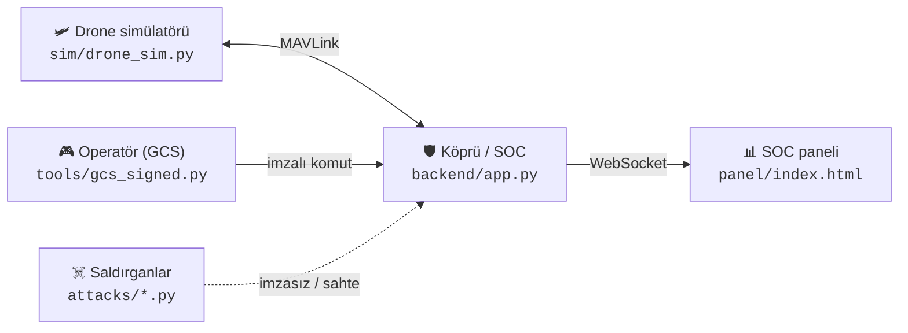

<div align="center">

# 🛩️ İHA Haberleşme Güvenliği ve Yapay Zeka Destekli SOC

**MAVLink saldırılarını gerçekleştiren, canlı tespit eden, raporlayan ve imzalama ile önleyen uçtan uca güvenlik demosu**


[Öne çıkanlar](#-öne-çıkanlar) •
[Mimari](#-mimari) •
[Kurulum](#-kurulum) •
[Çalıştırma](#-çalıştırma) •
[MITRE eşlemesi](#-saldırı--savunma--mitre-eşlemesi) •
[Dokümanlar](#-dokümanlar) •
[Geliştiriciler](#-geliştiriciler)

</div>

---

Simüle bir İHA'nın **MAVLink** haberleşmesine yapılan saldırıları gerçekleştiren,
canlı tespit eden, bir **SOC panelinde** gösteren, **MITRE ATT&CK for ICS** ile
eşleyen, yapay zeka ile raporlayan ve **MAVLink 2 mesaj imzalama** ile savunan
uçtan uca bir güvenlik demosu. Her şey tek bir dizüstü bilgisayarda, ek donanım
gerekmeden çalışır.

> [!WARNING]
> Eğitim ve savunma (defansif) güvenlik amaçlıdır. Saldırı betikleri yalnızca
> `127.0.0.1` üzerindeki yerel simülatöre yöneliktir.

## ✨ Öne çıkanlar

| | |
|---|---|
| ⚔️ **Ofansif** | 4 farklı saldırı: komut enjeksiyonu (kaçırma), GPS spoof, keşif, flood/DoS |
| 🛡️ **Defansif** | Kural tabanlı canlı tespit + MAVLink 2 imzalama (HMAC-SHA256) ile önleme |
| 📊 **SOC paneli** | Tarayıcıda canlı telemetri, olay akışı, şiddet seviyeleri ve MITRE etiketleri (WebSocket) |
| 🤖 **Yapay zeka** | Her olay için Türkçe müdahale raporu; anahtar yoksa şablon moduna düşer |
| 🗺️ **Çerçeve eşlemesi** | Her saldırı/savunma MITRE ATT&CK for ICS, ders konuları ve BG Rehberi tedbirleriyle eşlenir |

## 🏗️ Mimari



Ortadaki köprü hem telemetriyi hem komutları görür:

- kural tabanlı tespit yapar,
- savunma açıkken **imzasız komutları drona iletmeden reddeder**, imzalı meşru komutları geçirir,
- her alarm için yapay zeka destekli olay raporu üretir,
- tüm olayları WebSocket üzerinden panele aktarır.

## 📁 Dizin yapısı

```
sim/       drone_sim.py     – gerçek MAVLink konuşan hafif drone simülatörü
attacks/   inject_land.py   – komut enjeksiyonu (T0855)
           spoof_gps.py     – GPS/konum sahteciliği (T0830)
           recon.py         – keşif / bilgi toplama (T0888)
           flood.py         – flood / DoS (T0814)
backend/   app.py           – FastAPI + WebSocket SOC servisi (tespit + imzalama + YZ rapor)
panel/     index.html       – canlı SOC paneli (tarayıcı)
tools/     gcs_signed.py    – imzalı komut gönderen meşru operatör
           monitor.py       – bağımsız telemetri/anomali konsolu
docs/      proje, uygulama, demo, eşleme, soru ve kurulum belgeleri
```

## ⚙️ Kurulum

```bash
# Sanal ortam
python -m venv .venv

# Windows (PowerShell)
.venv\Scripts\Activate.ps1
# Linux / macOS
source .venv/bin/activate

pip install -r requirements.txt
```

> [!TIP]
> Windows için ayrıntılı adımlar: [docs/WINDOWS-KURULUM.md](docs/WINDOWS-KURULUM.md)

## ▶️ Çalıştırma

4 terminal açın (hepsinde sanal ortam aktif olsun):

```bash
# T1 — Backend + SOC paneli  →  http://localhost:8000
python backend/app.py

# T2 — Drone simülatörü
python sim/drone_sim.py --out 127.0.0.1:14560 --in 127.0.0.1:14571

# T3 — Saldırı (örnek: komut enjeksiyonu)
python attacks/inject_land.py --target 127.0.0.1:14561 --cmd LAND

# T4 — Meşru operatör (imzalı komut)
python tools/gcs_signed.py --target 127.0.0.1:14561 --cmd RTL
```

Tarayıcıda **http://localhost:8000** adresini açın. Panelin sağ üstündeki
**Savunma (imzalama)** düğmesi ile imzalama önlemini canlı olarak açıp kapatabilirsiniz.

📽️ Adım adım sunum senaryosu: [docs/DEMO.md](docs/DEMO.md)

## 🎯 Saldırı ↔ savunma ↔ MITRE eşlemesi

| Saldırı | Betik | MITRE ATT&CK (ICS) | Hedef ilke | Savunma |
|---|---|---|---|---|
| 💉 Komut enjeksiyonu | `inject_land.py` | T0855 Unauthorized Command Message | Bütünlük | MAVLink 2 imzalama |
| 📡 GPS spoof | `spoof_gps.py` | T0830 Adversary-in-the-Middle | Bütünlük | Girdi/sensör doğrulama |
| 🔍 Keşif | `recon.py` | T0888 Remote System Information Discovery | Gizlilik | En az yetki |
| 🌊 Flood / DoS | `flood.py` | T0814 Denial of Service | Erişilebilirlik | Hız sınırlama / anomali |

Tam eşleme (ders konuları ve BG Rehberi tedbir alanları ile birlikte):
[docs/ESLEME.md](docs/ESLEME.md)

## 🔐 Savunma: MAVLink 2 mesaj imzalama

Savunma açıkken köprü, imzasız `COMMAND_LONG` mesajlarını drona iletmeden
reddeder (**KOMUT REDDEDİLDİ**). Meşru operatör komutunu paylaşılan anahtarla
(HMAC-SHA256) imzaladığı için kabul edilir.

Böylece savunma her komutu değil, **yalnızca sahte/imzasız olanı** engeller.
Bu, komut enjeksiyonunun (T0855) kök çözümüdür.

## 🤖 Yapay zeka olay raporu

Her alarm için **ne oldu / etki / MITRE tekniği / müdahale önerisi** biçiminde
Türkçe bir rapor üretilir. LLM sağlayıcısı ortam değişkenleriyle yapılandırılır.
Anahtar tanımlı değilse sistem şablon tabanlı rapora düşer, böylece demo
internetsiz de çalışır.

<details>
<summary><b>LLM yapılandırması (opsiyonel)</b></summary>

```bash
# OpenAI-uyumlu bir sağlayıcı
export LLM_API_KEY=...            # Windows: setx LLM_API_KEY ...
export LLM_API_URL=...            # varsayılan: OpenAI uyumlu uç nokta
export LLM_MODEL=...              # örn. gpt-4o-mini
```

</details>

## 📚 Dokümanlar

| Belge | İçerik |
|---|---|
| [PROJE.md](docs/PROJE.md) | Proje tanımı ve kapsam |
| [UYGULAMA.md](docs/UYGULAMA.md) | Teknik uygulama ayrıntıları |
| [DEMO.md](docs/DEMO.md) | Canlı sunum senaryosu |
| [ESLEME.md](docs/ESLEME.md) | MITRE + ders + BG Rehberi eşlemesi |
| [SORULAR.md](docs/SORULAR.md) | Çoktan seçmeli sınav soruları |
| [WINDOWS-KURULUM.md](docs/WINDOWS-KURULUM.md) | Windows kurulum rehberi |

## 👥 Geliştiriciler

Bu proje birlikte geliştirilmiştir:

| | |
|---|---|
| **Ayşe Akdoğan**  | [@ayseakdogann](https://github.com/ayseakdogann) |
| **Melih Ali Çağman**  | [@MelihAliCagman](https://github.com/MelihAliCagman) |

## 📄 Lisans

MIT. Eğitim ve araştırma amaçlıdır; yalnızca kendi kontrolünüzdeki sistemlerde
kullanın.
